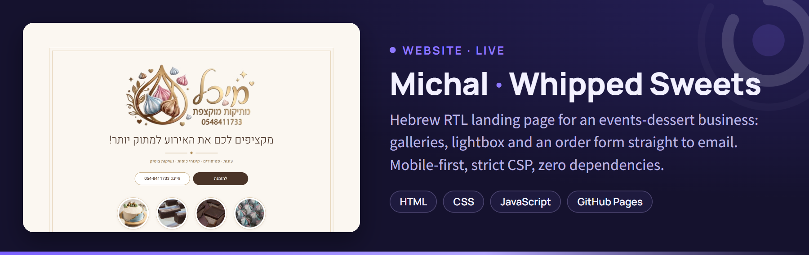
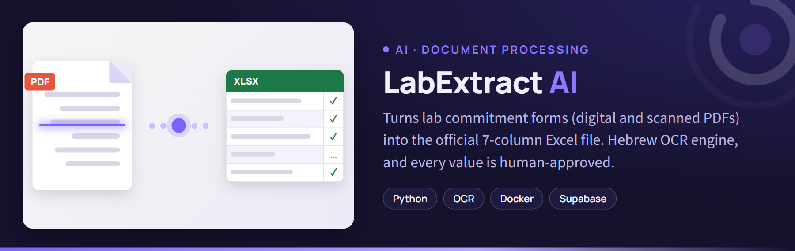

<picture>
  <source media="(prefers-color-scheme: dark)" srcset="assets/logo-dark.png">
  
</picture>

### Idea. Development. Click.

I turn ideas into working products, from AI document pipelines and IoT robots 
to fast, accessible websites.

 

## Featured projects

<a href="https://michal-sweets.github.io"><b>Live site</b></a> · <a href="https://github.com/michal-sweets/michal-sweets.github.io">Code</a>

<a href="https://labextract-ai-orpin.vercel.app"><b>Live demo</b></a> · <a href="https://github.com/chana-jobs/labextract-ai">Code</a>

<a href="https://drive.google.com/file/d/1MG78STgNTEv-HPWVZA0KQI0r78wlkXUO/view?usp=sharing"><b>Demo video</b></a> · <a href="https://github.com/chana-jobs/my-project-AromaID">Code</a>

 

## Toolbox

  
  
  
  
  
  
  
  
  
  
  
  
  

 

<b>klik lab</b> · רעיון. פיתוח. קליק.

